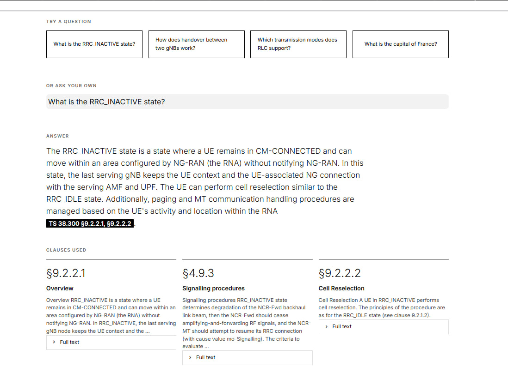
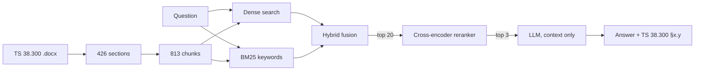

# ClauseFinder — 3GPP Spec Assistant

Ask a question about 5G NR and get a short answer that cites the exact section of the 3GPP standard it came from. The assistant searches **TS 38.300 V18.11.0** with keyword and semantic search, reranks the candidates, and lets an LLM answer **only** from the sections it found.

    



[How it works](#how-it-works) · [Results](#results) · [What the errors show](#what-the-errors-show) · [Run it](#run-it) · [Limits](#limits-and-next-steps)

> [!NOTE]
> A small reproduction of an idea explored by Ericsson researchers (TelcoGenAI, arXiv:2404.02929). In the TSpec-LLM study (arXiv:2406.01768), LLMs answered 44–51% of 3GPP questions correctly from memory and 71–75% with retrieval. This project measures retrieval on one specification.

## How it works



| Step | File | What happens |
| --- | --- | --- |
| Ingest | `ingest.py` | headings start sections; text, lists and notes are added to the current one; table of contents and cover page are skipped |
| Chunk | `chunk.py` | ~200 words with 30-word overlap, because the embedding model reads at most 256 tokens; each chunk keeps its section number |
| Embed | `embed.py` | 813 chunks → 384-number vectors |
| Retrieve | `retrieve.py` | dense + BM25 merged with reciprocal rank fusion, top 20 reranked by a cross-encoder |
| Answer | `answer.py` | top 3 chunks go to the LLM: cite every fact, or reply *"Not found in the provided sections"* |

## Results

20 hand-written questions, each with the section that holds the answer. **hit@k** = the right section is in the first k results.

| Method | hit@1 | hit@3 |
| --- | --- | --- |
| Dense (baseline) | 55% | 70% |
| BM25 | 50% | 65% |
| Hybrid | 60% | 90% |
| Dense + reranker | 85% | 90% |
| **Hybrid + reranker** (used) | **90%** | **95%** |

Per-question results: [`eval/results_compare.json`](eval/results_compare.json).

## What the errors show

- **The two searches fail on different questions.** BM25 wins on exact terms (*C-RNTI*, *network slicing*); dense search wins on paraphrases (*"What is paging used for?"*). Combining them covers both.
- **Better retrieval fixed a wrong answer.** *"How does a handover between two gNBs work without the core network?"* — with dense search the LLM described a handover to LTE; with hybrid + reranker it found §9.2.3.2.1 and answered correctly.
- **Remaining miss:** *"What does a gNB do?"* — *gNB* appears in most chunks, while §4.1 defines it with other words.

## Run it

```bash
python -m venv .venv && .venv\Scripts\activate   # macOS/Linux: source .venv/bin/activate
pip install -r requirements.txt
```

Put `38300-ib0.docx` (from the [3GPP archive](https://www.3gpp.org/ftp/Specs/archive/38_series/38.300/)) in `data/raw/` and create `.env` with `OPENAI_API_KEY` and `OPENAI_MODEL=gpt-4.1-mini-2025-04-14`.

```bash
python src/spec_assistant/ingest.py
python src/spec_assistant/chunk.py
python src/spec_assistant/embed.py
python src/spec_assistant/compare_retrieval.py   # results table
streamlit run app.py                             # demo
```

## Limits and next steps

- 20 questions, and the method was chosen on the same set; a held-out set (e.g. TeleQnA) is the next step.
- Retrieval is measured, answer correctness is not yet.
- One specification; tables and figures are not extracted.
- Next: TeleQnA evaluation, abbreviation expansion with the extracted dictionary, more specifications.
